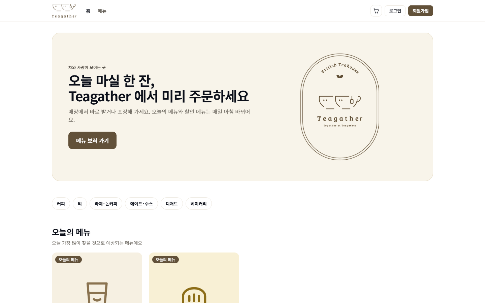
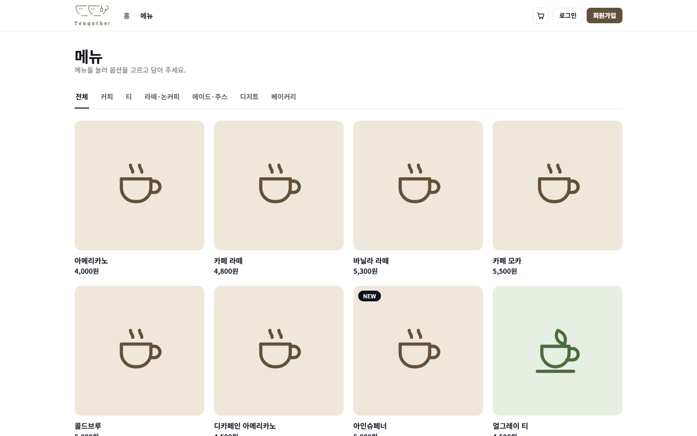
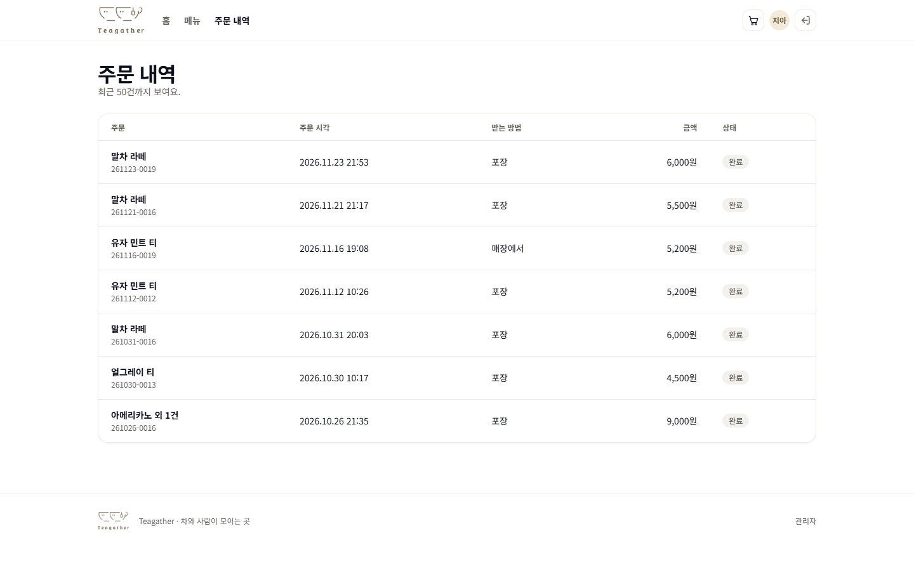
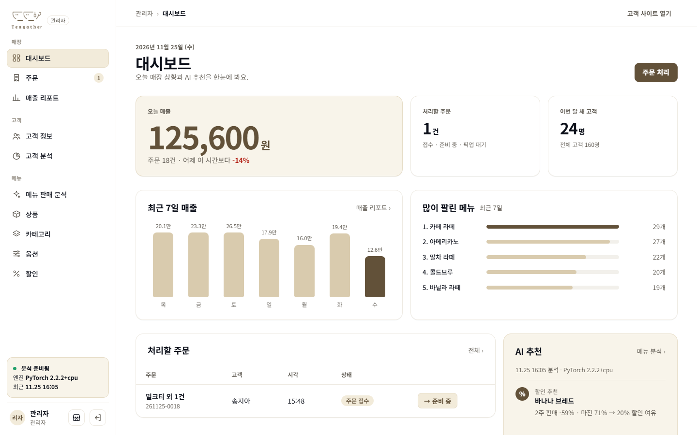
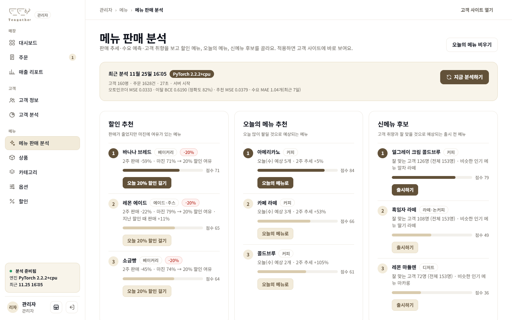
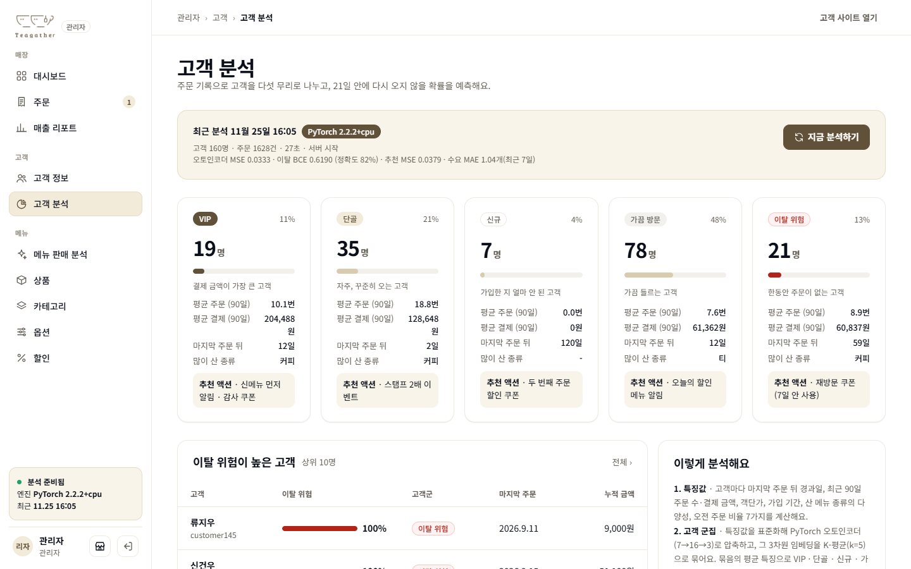

# Teagather — 카페 온라인 스토어

고객은 메뉴를 골라 미리 주문하고, 매장은 주문을 처리하면서 **PyTorch 분석**으로 할인·오늘의 메뉴·신메뉴를 추천받는 카페 자사몰입니다.

`Spring Boot 4.1` · `Java 21` · `Thymeleaf` · `JPA (H2 / MySQL)` · `Spring Security` · `Python / PyTorch` · `Micrometer`



## 화면

| 고객 · 메뉴 | 고객 · 주문 내역 |
|---|---|
|  |  |

| 관리자 · 대시보드 | 관리자 · 메뉴 판매 분석 |
|---|---|
|  |  |

| 관리자 · 고객 분석 |
|---|
|  |

## 주요 기능

- **고객** : 메뉴·옵션 선택, 장바구니, 포장/매장 주문, 주문 내역·취소, 개인 추천 메뉴
- **관리자** : 주문 처리(접수 → 준비 → 픽업), 매출 리포트·CSV, 상품·카테고리·옵션·할인 관리, 고객 정보
- **AI 분석** : 고객군(VIP·단골·신규·가끔·이탈 위험), 이탈 위험 예측, 고객별 추천, 오늘 판매 예측 → 할인 / 오늘의 메뉴 / 신메뉴 후보를 버튼 한 번으로 적용

| 모델 (PyTorch) | 쓰임 |
|---|---|
| 오토인코더 + K-평균 | 고객군 나누기 |
| 로지스틱 회귀 | 21일 안 재주문 여부 (이탈 위험) |
| 행렬 분해 (+ 메뉴 속성) | 고객별 추천, 신메뉴 선호도 (콜드 스타트) |
| MLP | 메뉴별 오늘 예상 판매 |

파이썬·PyTorch 가 없으면 Java 대체 계산으로 같은 화면을 채웁니다.

## 장애 대비 (주문 방어 로직)

동시 주문 한 건의 예외(주문번호 충돌)를 끝까지 추적해 주문 유실·장바구니 소실·포인트 불일치를 막았습니다.

| 시나리오 | 수정 전 | 수정 후 |
|---|---|---|
| 동시 주문 50건 × 5회 | 250건 중 160건 실패 (64%) | 실패 0건, 번호 중복·누락 0 |
| 같은 고객 동시 주문·취소 | 집계 어긋남 (5회 모두) | 5회 모두 정확 |
| 저장 실패 시 | HTTP 500, 거짓 "이미 처리한 주문서" 안내 | 주문서로 돌아가 안내, 장바구니 유지, DB 흔적 없음 |
| AI 할인 추천 더블클릭 | 할인 2건 생성 | 1건 |

- 일자별 카운터로 주문번호 발급, 회원 집계는 원자적 UPDATE, 재시도는 트랜잭션 바깥(Facade)에서
- 롤백 검증 테스트 40개 (`./gradlew test`) · 지표 `order.place.*` (`/actuator/metrics`, 관리자 전용)
- 리서치·결정 기록 : [`docs/research/order-defense-research.md`](docs/research/order-defense-research.md) · 수정 전 기준선 : [`docs/verification/baseline-before.md`](docs/verification/baseline-before.md)
- MySQL 실DB 검증(`./gradlew mysqlTest`, Docker 필요)은 준비만 되어 있고 아직 실행 전 : [`docs/verification/mysql-verification.md`](docs/verification/mysql-verification.md)

## 실행

```bash
./gradlew bootRun            # Windows : .\gradlew.bat bootRun (JDK 21)
pip install torch            # 선택 : PyTorch 분석 (Python 3.9+)
```

- 고객 http://localhost:8080 · `customer1` ~ `customer160` / `1234`
- 관리자 http://localhost:8080/admin · `admin` / `admin1234`
- 기본 DB 는 H2 파일(`data/teagather.mv.db`, 지우면 예시 데이터부터 다시 생성). MySQL : `--spring.profiles.active=mysql`
- 분석은 서버 첫 실행 때 한 번, 매일 05:00, 또는 관리자 > 메뉴 판매 분석 > **지금 분석하기**

화면·엔드포인트 목록 : [`docs/feature-inventory.md`](docs/feature-inventory.md)
